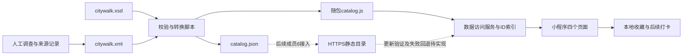

# 贵阳城市微旅

基于 XML 轻量级数据的 Citywalk 微信小程序。团队六人，成员1负责架构与集成，成员2～6按 Issue 自行认领。

当前交付是 **v0.1 架构与项目骨架**，不是已完成的旅游攻略产品。当前2条路线、3个点位均为未实地核验的联调草案。地图导航、打卡、联网更新及真机验证留给对应成员。

## 快速运行

环境：Node.js 20+、Python 3.9+、xmllint、微信开发者工具。

```sh
npm run data:build
npm run check
```

无 npm 第三方依赖，不必安装云服务。macOS通常自带xmllint；Ubuntu使用libxml2-utils；Windows团队可用WSL完成数据构建，微信开发者工具仍在Windows导入同一份项目。

微信开发者工具导入 **本仓库根目录**，填写自己的AppID（配置当前为touristappid），点击编译。不要只导入miniprogram目录。项目尚未在微信开发者工具编译或真机验证。

## 架构



## 目录

```text
data/source/             XML唯一主数据源
data/schema/             XSD约束
data/generated/          自动生成JSON，禁止手动维护
scripts/                 构建、校验及任务发布脚本
miniprogram/
  data/                  自动生成的运行时数据
  services/              公共数据接口与收藏服务
  pages/                 首页、路线、详情、我的
docs/                    架构、数据规范、六人分工、协作、验收
tests/                   数据负例与服务逻辑测试
.github/                 CI、Issue模板、PR模板与任务清单
```

## 成员先读

1. [架构设计](docs/architecture.md)
2. [XML数据规范](docs/xml-contract.md)
3. [六人任务与认领规则](docs/team-tasks.md)
4. [GitHub协作](CONTRIBUTING.md)
5. [验收与演示](docs/acceptance.md)

数据修改后运行 `npm run data:build`，把XML和生成物一起提交。CI会拒绝生成物漂移。

## 数据发布

`npm run data:release` 仅在所有路线和点位均为verified且具备规定来源/坐标时导出dist/catalog.json。当前草案执行此命令失败是预期行为。

后续部署拟使用既有服务器的独立路径，尚未部署、不改动诗词项目；参见[部署边界](docs/deployment.md)。

## GitHub状态

远程仓库计划名：`Ning-star0/guiyang-citywalk`。以实际创建结果为准。
本地的 `.github/tasks.json` 保存六人共12项可发布Issue任务。未获得成员账号时不伪造assignee，成员先评论认领，由负责人登记或分配。
